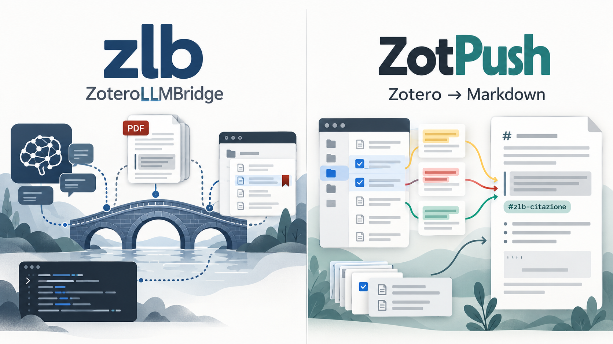
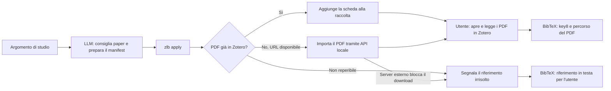

# zotero-llm-bridge (`zlb`)

*[English](README.md) · Italiano*



[](https://github.com/paolovolterra/zotero-llm-bridge/releases/latest)
[](https://doi.org/10.5281/zenodo.22900666)

[](LICENSE)

CLI locale per Zotero 10, utilizzabile da terminale, script e altri LLM su Linux, macOS e Windows. Il comando breve è `zlb`. Usa `http://localhost:23119/api/` con Zotero aperto. Tutte le scritture passano dall'API locale; non modifica i database SQLite e non usa zotero.org.

## Novità nella 0.3.0

> [!NOTE]
> Versione 0.3.0 del 2026-11-19 ([note della release](https://github.com/paolovolterra/zotero-llm-bridge/releases/tag/v0.3.0)). Archivio su Zenodo: [10.5281/zenodo.24374740](https://doi.org/10.5281/zenodo.24374740).

| Novità | Che cosa fa | Scrive in Zotero? |
|---|---|---|
| [Citation key = key8](#citation-key--key8) | `upload` e `apply` impostano la citation key della scheda alla key8 del PDF; nuovi comandi `citekey` e `citekey-all` per le schede esistenti | Sì; `--keep-citekey` / `--keep` per non farlo; `citekey-all` è una prova a vuoto senza `--apply --backup` |
| [Tag esistenti automatici](#tag-esistenti-sui-nuovi-import) | Un modello Ollama locale sceglie fino a N tag **già presenti nella libreria** per ogni nuovo PDF | **Su richiesta**: spenti per default; `--tag-count N`, `ZLB_TAG_COUNT` o `config.json` |
| Chiavi BibTeX | `key8` ora è la chiave del PDF (il percorso di storage); `zotero_item` è la scheda; i PDF senza scheda usano la key8 come chiave BibTeX (prima `zoteroKEY8`) | No |

> [!IMPORTANT]
> Due cambi di comportamento rispetto alla 0.2.0: la chiave BibTeX dei PDF senza scheda passa da `zoteroKEY8` a `KEY8`, e i valori espliciti di `upload --tag` devono già esistere nella libreria.

Restano invariati i principi: nessuna cancellazione, nessuna scrittura su SQLite, solo API locale. La versione 0.2.0 ha aggiunto `highlight`, `screen`, `compare`, `tag` e `untag` ([release](https://github.com/paolovolterra/zotero-llm-bridge/releases/tag/v0.2.0)).

## Da una richiesta all'LLM alla raccolta Zotero

Durante uno studio o una ricerca, l'utente può chiedere a un LLM di consigliare paper su un tema, cercarne i PDF online e scrivere `references.bib`. 

`zlb` porta i PDF reperiti nella libreria Zotero direttamente senza download manuali.

L'utente poi può aprirli, leggerli e annotarli .

Ad un LLM si può chiedere, per esempio:

> «Consigliami paper pertinenti a questo argomento e spiegami perché leggerli. Cerca prima i PDF già presenti in Zotero e aggiungili alla raccolta `Letture consigliate`. Per gli altri cerca PDF accessibili sul web e importali nella stessa raccolta: voglio leggerli in Zotero. Scrivi `references.bib` con `key8` e percorso dei PDF risolti. Metti all'inizio i paper che non riesci a reperire, così posso cercarli io.»



L'LLM conduce la ricerca bibliografica e sul web con gli strumenti di cui dispone, verifica le corrispondenze e prepara un [manifest JSON](#riferimenti-e-bibtex) con titolo, DOI, chiave Zotero o `pdf_url`. `zlb` esegue la parte locale: cerca nell'intera libreria, collega alla raccolta le schede già presenti, importa i PDF nuovi tramite l'API locale e produce il BibTeX. L'utente apre i PDF in Zotero per leggerli e valutare i suggerimenti. Un esempio del passaggio finale è:

```bash
zlb ensure-collection --name "Letture consigliate"
zlb apply --manifest references.json --collection "Letture consigliate" --output references.bib
```

Se un PDF non si trova o un server esterno rifiuta il download, `apply` segnala `missing` o `error` per quel riferimento. La voce resta **all'inizio del BibTeX**, senza `key8` o percorso inventati: l'utente può procurare il PDF o correggere l'URL e riprendere dal manifest. Il CLI non effettua da solo ricerche sul web e non aggira blocchi o autorizzazioni dei siti. Se invece è il server locale di Zotero a non rispondere, occorre riaprire Zotero e ripetere il comando prima di generare il BibTeX.

## Avvertenza e responsabilità

`zlb` può modificare raccolte e schede e copiare PDF nella libreria Zotero. L'utilizzatore deve leggere il codice, controllare i comandi proposti anche da un LLM, verificare i risultati e mantenere un backup della libreria. Deve inoltre verificare identità, metadati e diritti d'uso dei documenti importati. Il programma è fornito **«così com'è»**, senza garanzie di correttezza, idoneità o assenza di errori. Nei limiti consentiti dalla legge applicabile, autori e contributori declinano responsabilità per perdite di dati, errori bibliografici o altri danni derivanti dall'uso del programma.

**zlb non cancella schede, raccolte o allegati da Zotero.** Non offre un comando di cancellazione e rifiuta le richieste `DELETE` all'API locale. La cancellazione, quando necessaria, viene eseguita manualmente dall'utente nell'interfaccia di Zotero. `move` cambia soltanto l'appartenenza della scheda alle raccolte: la scheda e il suo PDF restano nella libreria.

## Licenza

Il codice è distribuito con licenza [0BSD](LICENSE): si può usare, copiare, modificare e ridistribuire per qualunque scopo, anche commerciale, senza obbligo di attribuzione. La licenza include l'esclusione di garanzie e responsabilità nel suo testo originale.

## Citazione e archivio

La versione 0.3.0 è archiviata su [Zenodo](https://doi.org/10.5281/zenodo.24374740) con DOI `10.5281/zenodo.24374740`; il DOI di concetto [`10.5281/zenodo.22900666`](https://doi.org/10.5281/zenodo.22900666) punta sempre all'ultima versione. Restano disponibili le versioni 0.2.0 (`10.5281/zenodo.23875898`) e 0.1.0 (`10.5281/zenodo.22900667`). Il repository GitHub contiene il codice e gli aggiornamenti; il DOI di versione identifica lo snapshot pubblicato. I metadati di citazione per GitHub sono in [CITATION.cff](CITATION.cff).

La versione 0.2.0 aggiunge `tag`, `untag`, `screen`, `compare` e `highlight` ed è stata verificata dal vivo su Linux con Zotero 10.0.7. La versione 0.3.0 aggiunge citation key = key8, i comandi `citekey` e i tag automatici su richiesta.

SHA-256 dello ZIP `zotero-llm-bridge-v0.3.0.zip` scaricato da Zenodo:

```text
6bd26cb460c6e0a7ebe9b92a73ca8bd9471dbf6b3292b87305793f95c700eea0
```

Verifica: `sha256sum zotero-llm-bridge-v0.3.0.zip` su Linux, `shasum -a 256 zotero-llm-bridge-v0.3.0.zip` su macOS oppure `Get-FileHash .\zotero-llm-bridge-v0.3.0.zip -Algorithm SHA256` in PowerShell. L'hash si riferisce allo ZIP di Zenodo, non al codice aggiornato su GitHub.

## Installazione

Servono Zotero 10 aperto, l'opzione **Settings → Advanced → Allow other applications on this computer to communicate with Zotero** attiva e Python 3.10 o successivo. Non serve installare un'estensione `.xpi` né creare una chiave su zotero.org. Il repository è pubblico e si può clonare senza un account GitHub.

### Linux e macOS

```bash
git clone https://github.com/paolovolterra/zotero-llm-bridge.git
cd zotero-llm-bridge
python3 --version
mkdir -p "$HOME/.local/bin"
ln -s "$PWD/zlb" "$HOME/.local/bin/zlb"
export PATH="$HOME/.local/bin:$PATH"
zlb status
```

Il clone pubblico non richiede credenziali GitHub. Il collegamento in `~/.local/bin` si crea una sola volta; per aggiornare il programma basta `git pull` nella cartella clonata. Rendere persistente l'aggiunta al `PATH` nel profilo della propria shell, se non è già configurata.

### Windows

```powershell
git clone https://github.com/paolovolterra/zotero-llm-bridge.git
cd zotero-llm-bridge
py -3 --version
py -3 -m pip install --user .
zlb status
```

Se `zlb` non è riconosciuto, aggiungere al `PATH` la directory `Scripts` dell'installazione Python dell'utente. In alternativa, dalla cartella del repository si può sempre eseguire `py -3 PY\zotero_llm_bridge.py status`.

### Da un archivio del codice

Se si dispone dello ZIP del codice, estrarlo e aprire un terminale nella cartella `zotero-llm-bridge-v0.3.0`. Su Linux/macOS eseguire `./zlb status`; su Windows eseguire `py -3 PY\zotero_llm_bridge.py status` oppure `py -3 -m pip install --user .` e poi `zlb status`. L'archivio contiene una copia autonoma del CLI.

## Modello d'uso

Un LLM può cercare fonti sul web, preparare un manifest e invocare i comandi del CLI. Chi utilizza il pacchetto può leggere il codice e decide quali operazioni autorizzare ed eseguire sulla propria libreria. Il CLI usa le richieste e l'autorizzazione dell'API locale di Zotero: è Zotero a creare le chiavi, registrare le schede e gestire i file importati. I controlli del CLI verificano appartenenza alla raccolta e integrità dei PDF, ma non accertano da soli che un documento sia il paper citato o che i suoi metadati siano corretti.

## Avvio

```bash
./zlb status
./zlb collections --parent "My papers"
./zlb collections "My papers"
./zlb "My papers" --top --limit 20
```

`zlb collections "My papers"` elenca le sottoraccolte; `zlb "My papers"` elenca schede e allegati nella raccolta. Aggiungere `--top` per vedere solo le schede principali. La forma breve equivale a `zlb search --collection "My papers"`. Il nome deve essere esatto e univoco; se non lo è, usare la chiave a otto caratteri.

### Esempio reale: `PolicyIA`

```bash
zlb -h
zlb collections PolicyIA
zlb PolicyIA --top --limit 5
zlb search --collection PolicyIA --tag AI --top --limit 20
zlb bib --collection PolicyIA
zlb bib --collection PolicyIA --output PolicyIA.bib
```

`zlb collections PolicyIA` mostra le **sottoraccolte**: nella prova del 22 settembre ha restituito `[]`. `zlb PolicyIA --top --limit 5` mostra le prime cinque dei 53 item principali osservati. `zlb bib --collection PolicyIA` stampa il BibTeX della raccolta sul terminale; con `--output` lo salva nella directory corrente. L'esportazione diretta usa il traduttore BibTeX di Zotero per le schede bibliografiche, include i PDF autonomi come voci `misc` e aggiunge `key8`. Le note autonome vengono saltate e riportate nel riepilogo JSON quando si usa `--output`. Non serve un manifest per questi comandi.

L'export rispecchia i metadati presenti in Zotero: se mancano autori, date o sede editoriale, il `.bib` può produrre avvisi durante la compilazione. La correzione dei metadati si fa in Zotero e poi si ripete l'esportazione. L'[API ufficiale supporta BibTeX come formato di export](https://www.zotero.org/support/dev/web_api/v3/basics).

I comandi restituiscono JSON. Le letture non richiedono autorizzazione; le scritture seguono la procedura qui sotto.

### Autorizzazione delle scritture

Alla prima operazione che modifica Zotero (`ensure-collection`, `add`, `move`, `upload`, `highlight --apply` o `apply`), il client aperto mostra una richiesta per **ZoteroLLMBridge**:

- **Allow** autorizza una sola scrittura. Un'operazione composta da più scritture, come l'upload di un PDF, può richiedere altre conferme.
- **Always Allow** restituisce una chiave riutilizzabile. `zlb` la salva localmente e le scritture successive non mostrano un nuovo prompt finché l'autorizzazione resta valida.
- **Deny** rifiuta l'operazione; `zlb` non salva alcuna chiave.

La cache predefinita è `~/.config/zotero_llm_bridge/auth.json` su Linux/macOS oppure `%APPDATA%\\zotero_llm_bridge\\auth.json` su Windows. Si può scegliere un altro file con `ZOTERO_LLM_BRIDGE_AUTH_FILE`. La cache contiene la chiave e l'identificativo dell'istanza Zotero, non le credenziali di zotero.org; su Linux/macOS il file è creato con permessi `0600`. La copia di lavoro condivisa usa invece `.zotero-local-auth.json` nella cartella del pacchetto, esclusa da Git. Una chiave associata a un'altra istanza non viene riusata. Se Zotero rifiuta una chiave salvata (`401`), il CLI la elimina e richiede una nuova autorizzazione.

`zlb status` mostra `remembered_authorization: true` quando trova una cache per l'istanza corrente; questo indica la presenza della chiave, non ne prova ancora la validità. Si possono revocare le autorizzazioni ricordate in Zotero: **Settings → Advanced → Clear Write Authorizations**. La chiave non va copiata in un repository o condivisa con altri utenti. La [documentazione ufficiale dell'API locale](https://www.zotero.org/support/dev/web_api/v3/local_api) descrive il prompt e la revoca.

## Ricerca

```bash
./zlb search --collection "My papers" --q "credit risk"
./zlb search --tag QEF --item-type=-attachment --top --limit 20
./zlb search --tag "QEF || AI" --q "default" --qmode everything
./zlb search --tag QEF --tag PMI --start 20 --limit 20
```

`--collection` accetta la chiave a otto caratteri o un nome esatto e univoco. Filtri diversi si combinano; più `--tag` richiedono tutti i tag (AND). Nelle espressioni di tag e tipo item, `||` significa OR e il prefisso `-` esclude un valore. `--q` è la ricerca testuale di Zotero, che tratta la stringa come frase; non interpreta operatori booleani generici. `--qmode everything` estende la ricerca al testo integrale indicizzato. I risultati sono paginati con `--start` e `--limit` (massimo 100 per pagina). `--top` esclude gli allegati figli.

### Ricerca filtrata da un LLM locale e confronto fra due giudici

La ricerca full-text di Zotero trova anche omonimi (per esempio «Epic» think tank, Epic Games, «epic» aggettivo).
`screen` estrae dagli allegati trovati i passi attorno ai termini indicati e chiede a un modello locale Ollama se ogni allegato parla davvero del soggetto descritto in `--about`.
Per impostazione predefinita `screen` privilegia il recall: si chiede al modello di rispondere «sì» nel dubbio e un errore del modello conta come corrispondenza; `--strict` privilegia la precisione.
Le `--phrase` (maiuscole indifferenti) valgono come corrispondenze certe e non passano dal modello; i `--term` sono parole intere con maiuscole rispettate.
Il modello predefinito è `qwen3.8:27b-iq3-mtp` (variabile `ZLB_SCREEN_MODEL`): gli stessi pesi di `qwen3.8:27b-iq3` con la testa MTP, usata per la decodifica speculativa con 2 token di bozza (`ZLB_MTP_DRAFT`, 0 la disattiva); su 142 giudizi reali stessi sì/no del modello senza MTP, tempo −15%.
Il modello si crea dal GGUF di ISTA-DASLab con un Modelfile Ollama che carica anche la testa MTP.
zlb accetta solo un Ollama su `localhost`, così i testi non lasciano la macchina.

```bash
./zlb screen --q "Epic Draghi" \
  --about "the Brussels think tank European Policy Innovation Council (EPIC)" \
  --term Epic --term EPIC --phrase "European Policy Innovation Council" \
  --output screen.json --snippets blind.json
./zlb compare --screen screen.json --verdicts other.json --output compare.json
```

`--snippets` scrive gli stessi passi senza i giudizi del modello locale: un secondo giudice (per esempio l'LLM che guida la sessione) li valuta alla cieca e scrive `other.json` nella forma `{"KEY8": {"match": true, "reason": "..."}}`.
`compare` riporta accordo, casi trovati solo dal modello locale, casi trovati solo dall'altro giudice e item non giudicati.
I disaccordi vanno risolti leggendo il documento.
Con `--tag NOME` (ripetibile) `screen` aggiunge subito il tag a ogni corrispondenza (frase certa o «sì» del modello), senza togliere altri tag; i tag sbagliati si tolgono con `zlb untag` o a mano in Zotero.
Senza `--tag`, nessuna scrittura: i tag si mettono dopo la verifica con `zlb tag`.

### Ricerca semantica su molti PDF

Per domande sul contenuto dei paper, è consigliato un indice semantico separato: estrarre il testo degli allegati Zotero, dividerlo in chunk con pagina o posizione, calcolare gli embedding e ingerirli in shard FAISS. Una mappa persistente deve collegare ogni chunk alla chiave dell'allegato, alla scheda madre, al percorso del PDF e alla posizione nel documento. Conservare anche un hash del file per aggiornare o invalidare i chunk quando il PDF cambia.

Il flusso di ricerca può combinare i due livelli: prima restringere per raccolta, tag, tipo e metadati tramite API Zotero; poi cercare semanticamente nei chunk degli allegati selezionati e riportare sempre il passo, la pagina e la scheda originale. Il risultato semantico è una pista da verificare sul PDF, non un metadato Zotero. `ZoteroLLMBridge` espone oggi il livello API; non costruisce né interroga gli shard FAISS. Se esiste già un corpus indicizzato, riusarlo prima di crearne un altro.

## Raccolte e schede esistenti

```bash
./zlb ensure-collection --parent "My papers" --name "New collection"
./zlb add --collection "New collection" ABCD1234
./zlb move --source "My papers" --target "New collection" ABCD1234
./zlb tag --tag Draghi --tag EPIC ABCD1234 EFGH5678
```

`add` conserva le altre appartenenze. `move` toglie la scheda dalla raccolta sorgente e la aggiunge alla destinazione. La chiave può riferirsi anche a un allegato: il comando risale alla scheda madre. Le operazioni sono idempotenti e verificano il risultato via API.

`tag` aggiunge uno o più tag (`--tag` ripetibile) alle chiavi indicate, così come sono (scheda o allegato), senza togliere i tag esistenti; i tag già presenti sono saltati e il risultato è verificato via API. `untag` toglie solo i tag indicati (`--tag` ripetibile) dalle chiavi indicate, lascia gli altri tag e le schede, verifica via API: `./zlb untag --tag Draghi ABCD1234`.

## PDF

```bash
./zlb upload --file /path/to/article.pdf --collection "New collection" --title "Article title"
./zlb upload --file /path/to/article.pdf --collection "New collection" --parent-item ABCD1234
```

Il PDF originale resta sul disco. Prima di creare un allegato, `upload` controlla l'MD5 degli allegati PDF **nell'intera libreria** tramite un indice locale ricavato dall'API Zotero e conferma il candidato confrontando SHA-256 con il file nello storage. Se il PDF esiste già, aggiunge la scheda alla raccolta richiesta e restituisce `already_present` o `added_existing_pdf`, senza duplicare il file né cambiare titolo o tag. Se è indicato `--parent-item` ma la copia identica appartiene a un'altra scheda, si ferma e segnala le due chiavi. La prima costruzione dell'indice può richiedere alcuni minuti in una libreria grande; dopo, il CLI usa la versione della libreria per aggiornare solo gli allegati modificati. La cache `.zlb-attachment-index.json` resta locale ed è esclusa da Git.

### Citation key = key8

Quando `upload` o `apply` mettono un PDF sotto una scheda bibliografica (o lo trovano già lì), `zlb` imposta la **citation key** della scheda in Zotero alla key8 del PDF, cioè la chiave della cartella in `storage/KEY8/file.pdf`.
L'export BibTeX di Zotero usa così la key8 come citation key, e la stessa fonte ha la stessa chiave in ogni progetto.
I PDF senza scheda non hanno il campo citation key in Zotero: la loro chiave BibTeX è la key8 stessa.
Con `--keep-citekey` la citation key resta invariata.

```bash
./zlb citekey KEY8 [KEY8 ...] [--keep]                       # su item esistenti (chiave del PDF o della scheda)
./zlb citekey-all                                           # una tantum, tutta la libreria: prova a vuoto con i conteggi
./zlb citekey-all --apply --backup citekeys_prima.csv      # scrive; le chiavi precedenti sono salvate prima, poi verificate
```

Le schede con più di un PDF sono saltate.
Nel BibTeX `key8` è la chiave del PDF (il percorso) e `zotero_item` quella della scheda, se diversa.

Il limite di upload è 100 MB per file. Zotero assegna le chiavi a otto caratteri. `zlb` non avvia né corregge i metadati: il loro recupero e controllo si svolgono direttamente in Zotero.

### Tag esistenti sui nuovi import

I tag automatici sono **spenti per default**, perché richiedono un modello Ollama locale. Se attivati, i nuovi PDF importati con `upload` e `apply` ricevono **fino a N tag pertinenti già presenti in Zotero**.
Il CLI legge il vocabolario tramite API locale, ordina i candidati in base al testo e al titolo e chiede a Ollama locale di selezionarne gli identificativi.
Non accetta nomi inventati; anche i valori espliciti di `upload --tag` devono già esistere nella libreria.
I PDF riutilizzati dalla deduplicazione conservano i tag presenti.
I tag vengono applicati al nuovo allegato PDF, anche quando collegato a una scheda bibliografica.

```bash
zlb upload --file paper.pdf --collection "Nuova raccolta"              # nessun tag automatico (default)
zlb upload --file paper.pdf --collection "Nuova raccolta" --tag-count 5
zlb apply --manifest references.json --collection "Nuova raccolta" --tag-count 10
zlb upload --file paper.pdf --collection "Nuova raccolta" --tag-count 0  # spenti per un solo comando
```

Per attivarli sempre, impostare `ZLB_TAG_COUNT=10` oppure creare `config.json` nella stessa cartella della cache delle autorizzazioni (`~/.config/zotero_llm_bridge/` su Linux/macOS, `%APPDATA%\\zotero_llm_bridge\\` su Windows; altro percorso con `ZLB_CONFIG_FILE`):

```json
{"tag_count": 10}
```

Precedenza: `--tag-count`, poi `ZLB_TAG_COUNT`, poi `config.json`, altrimenti 0.

`--tag-count` limita i tag automatici; quelli espliciti già esistenti sono aggiuntivi, senza doppioni.
Se i tag pertinenti sono meno, ne vengono applicati meno; con vocabolario vuoto non se ne applicano.
Servono `pdftotext` di Poppler e Ollama locale; il modello si sceglie con `--tag-model` o `ZLB_TAG_MODEL` (altrimenti viene usato quello di `screen`).
Sono ammessi solo endpoint HTTP locali per Ollama.
Con i tag automatici attivi, PDF senza testo estraibile ed errori del modello fermano l’importazione prima della creazione dell’allegato: eseguire OCR, riprovare oppure usare `--tag-count 0`.
Il risultato JSON riporta i tag applicati, verificati tramite API.

La preselezione usa la sovrapposizione lessicale sul testo completo; il modello sceglie fra massimo 160 candidati leggendo estratti distribuiti nel PDF.
Può non recuperare sinonimi o tag in un’altra lingua esclusi dalla preselezione; il numero richiesto è un massimo, non una garanzia di qualità.

### Evidenziare nel PDF i passaggi citati

`highlight` individua nel testo di un allegato PDF i passaggi dichiarati in un manifest JSON e ne calcola le coordinate. Per impostazione predefinita esegue soltanto un'anteprima; `--apply` crea in Zotero annotazioni `highlight` figlie dell'allegato.

```bash
zlb highlight --manifest passages.json
zlb highlight --manifest passages.json --color gray --apply
```

Il formato è mostrato in [`examples/highlight_manifest.json`](examples/highlight_manifest.json). Il manifest indica la chiave dell'allegato Zotero e una lista `passages`. Ogni passaggio contiene:

- `id`, identificatore stabile;
- `text`, per una frase esatta, oppure `start` e `end` per un intervallo più lungo;
- `page`, facoltativo ma consigliato, come etichetta editoriale mostrata da Zotero;
- `page_index`, facoltativo e con base zero, per limitare la ricerca a una pagina fisica quando tavole o intestazioni producono più corrispondenze.
- `match_index`, facoltativo e con base zero, per scegliere esplicitamente una delle occorrenze rimaste dopo il filtro di pagina; va usato solo dopo aver controllato il dry-run.

`--attachment KEY8` può sostituire la chiave contenuta nel manifest. Il colore predefinito è il grigio Zotero `#aaaaaa`; sono accettati anche `yellow`, `red`, `green`, `blue`, `purple`, `magenta`, `orange` oppure un valore `#rrggbb`. Il tag predefinito è `zlb-citazione` e può essere cambiato con `--tag`.

La ricerca normalizza maiuscole, apostrofi, punteggiatura, legature e interruzioni di riga. Il numero di pagina dichiarato non viene usato come indice fisico: la frase viene cercata nel PDF e `page` resta l'etichetta editoriale. Questo evita errori dovuti a copertine e pagine iniziali non numerate. Se un passaggio manca o compare più volte, l'anteprima riporta `not-found` o `ambiguous` e `--apply` rifiuta l'intera scrittura. Le annotazioni create contengono un'impronta nel commento e una seconda esecuzione con lo stesso manifest le riconosce senza duplicarle.

La funzione richiede `pdftotext` di Poppler nel `PATH`. Funziona sui PDF con testo e coordinate estraibili; per scansioni prive di OCR, testi distribuiti su più pagine o impaginazioni che confondono l'ordine di lettura occorre preparare o verificare manualmente i passaggi. `zlb` non interpreta autonomamente le parafrasi: un LLM o l'autore deve dichiarare nel manifest il passo sorgente effettivamente usato.

### Se qualcosa è già presente

- `ensure-collection` riusa la raccolta con lo stesso nome sotto lo stesso padre e restituisce `created: false`; se il nome è ambiguo, chiede una chiave a otto caratteri.
- `add` non duplica l'appartenenza. `move` restituisce `changed: 0` se la scheda è già nella destinazione e non è più nella sorgente. Nessuno dei due comandi modifica i tag.
- `upload` riusa un PDF identico già presente in libreria. I `--tag` sono applicati solo quando viene creato un nuovo allegato; non aggiornano una scheda preesistente.
- `apply` cerca prima la scheda per chiave, DOI o titolo e aggiunge alla raccolta quella con PDF già disponibile. Le corrispondenze bibliografiche ambigue richiedono verifica; il CLI non corregge i metadati.

## Riferimenti e BibTeX

Manifest JSON di esempio:

```json
{
  "source": {"title": "Paper di origine"},
  "references": [
    {"id": "1", "citekey": "rossi2025", "type": "article", "title": "Titolo", "author": "Rossi, Mario", "year": "2025", "doi": "10.1234/example", "zotero_key": "ABCD1234"},
    {"id": "2", "citekey": "bianchi2024", "title": "Altro titolo", "pdf_path": "/path/to/another.pdf"},
    {"id": "3", "citekey": "verdi2023", "title": "Terzo titolo", "pdf_url": "https://example.org/paper.pdf"}
  ]
}
```

```bash
./zlb apply --manifest /path/to/references.json --collection "New collection" --output /path/to/references.bib
./zlb bib --manifest /path/to/references.json --collection "New collection" --output /path/to/references.bib
```

`apply` cerca per chiave Zotero, DOI o titolo nell'intera libreria; aggiunge le schede già presenti e importa PDF locali o da URL HTTPS. Aggiorna il manifest dopo ogni importazione riuscita, così può riprendere dopo un'interruzione. `bib` **con manifest** richiede `--output`, mette le voci senza PDF all'inizio e scrive `key8` e percorso per quelle risolte. `bib` **senza manifest** esporta direttamente la raccolta con i metadati correnti di Zotero. Il CLI controlla la presenza del PDF, non l'identità scientifica di un URL: verificare fonte, titolo, autori, anno e DOI prima di associare il PDF e pubblicare il BibTeX.

## Per altri LLM

Fornire questa guida e il comando `zlb` disponibile nel `PATH`, oppure il suo percorso assoluto. Il CLI richiede Python 3.10+ e la libreria standard. Su Linux e macOS si può usare il wrapper Bash `zlb`; su Windows si può eseguire `py -3 PY\\zotero_llm_bridge.py --help` dalla cartella del pacchetto. `pyproject.toml` offre un entry point installabile `zlb` su tutte le piattaforme. `zlb --help` mostra tutti gli argomenti.

## Sviluppo

```bash
python3 -m unittest discover -s tests -v
```

I test non richiedono Zotero e coprono il riuso di un PDF già presente in libreria e l'ordine delle voci nel BibTeX. Prima di una pubblicazione pubblica occorre verificare il pacchetto sulle piattaforme dichiarate; finora è stato eseguito dal vivo solo su Linux.

Esempi basati su un caso d'uso reale sono in `examples/uso_20260922.md`.
