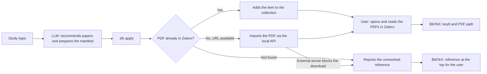

# zotero-llm-bridge (`zlb`)

*English · [Italiano](README.it.md)*

[](https://github.com/paolovolterra/zotero-llm-bridge/releases/latest)
[](https://doi.org/10.5281/zenodo.22900666)

[](LICENSE)

A local CLI for Zotero 10, usable from the terminal, from scripts and by LLM agents on Linux, macOS and Windows. The short command is `zlb`. It talks to `http://localhost:23119/api/` while Zotero is open. All writes go through the local API; it never modifies the SQLite databases and does not use zotero.org.

## What's new in 0.2.0

> [!NOTE]
> Version 0.2.0, released 2026-11-02, verified live with **Zotero 10.0.7** on Linux. Archived on Zenodo: [10.5281/zenodo.23875898](https://doi.org/10.5281/zenodo.23875898). Full notes in the [release](https://github.com/paolovolterra/zotero-llm-bridge/releases/tag/v0.2.0).

| Command | What it does | Writes to Zotero? |
|---|---|---|
| [`highlight`](#highlight-quoted-passages-in-the-pdf) | Finds the quoted sentences declared in a manifest inside a PDF attachment and creates native Zotero highlight annotations, gray by default | Only with `--apply`, after a dry-run in which every passage is unique |
| [`screen`](#full-text-search-filtered-by-a-local-llm-and-two-judge-comparison) | Filters full-text search results with a local Ollama model (`localhost` only), discarding homonyms; recall-oriented, `--strict` for precision | Only with `--tag` |
| [`compare`](#full-text-search-filtered-by-a-local-llm-and-two-judge-comparison) | Compares `screen` verdicts with those of a blind second judge and reports agreement and disagreements | No |
| [`tag`](#existing-collections-and-items) / [`untag`](#existing-collections-and-items) | Adds or removes named tags on items or attachments, leaving other tags untouched; writes in batches of 50 | Yes |

```bash
zlb highlight --manifest passages.json            # dry-run: exact / ambiguous / not-found
zlb highlight --manifest passages.json --apply    # create the highlights
zlb screen --q "Epic Draghi" --about "the Brussels think tank EPIC" --term EPIC --output screen.json
zlb tag --tag EPIC ABCD1234 && zlb untag --tag EPIC ABCD1234
```

The principles are unchanged: no deletions, no SQLite writes, local API only.

## From an LLM request to a Zotero collection

While studying a topic, you can ask an LLM to recommend papers, look for their PDFs online and write `references.bib`.

`zlb` brings the PDFs it found straight into your Zotero library, with no manual downloads.

You then open, read and annotate them in Zotero.

For example, you can ask an LLM:

> "Recommend papers relevant to this topic and explain why I should read them. First look for PDFs already in Zotero and add them to the `Recommended reading` collection. For the others, find PDFs accessible on the web and import them into the same collection: I want to read them in Zotero. Write `references.bib` with the `key8` and path of the resolved PDFs. Put the papers you cannot find at the top, so I can look for them myself."



The LLM does the bibliographic and web search with whatever tools it has, checks the matches and prepares a [JSON manifest](#references-and-bibtex) with title, DOI, Zotero key or `pdf_url`. `zlb` does the local part: it searches the whole library, links items already present to the collection, imports new PDFs through the local API and produces the BibTeX. You open the PDFs in Zotero to read them and judge the suggestions. A typical final step:

```bash
zlb ensure-collection --name "Recommended reading"
zlb apply --manifest references.json --collection "Recommended reading" --output references.bib
```

If a PDF cannot be found or an external server refuses the download, `apply` reports `missing` or `error` for that reference. The entry stays **at the top of the BibTeX**, with no invented `key8` or path: you can obtain the PDF or fix the URL and resume from the manifest. The CLI does not search the web by itself and does not bypass site blocks or authorisations. If instead the local Zotero server does not respond, reopen Zotero and repeat the command before generating the BibTeX.

## Disclaimer and liability

`zlb` can modify collections and items and copy PDFs into the Zotero library. Users must read the code, check the commands proposed (including by an LLM), verify the results and keep a backup of the library. They must also verify the identity, metadata and usage rights of imported documents. The software is provided **"as is"**, with no warranty of correctness, fitness or absence of errors. To the extent permitted by applicable law, authors and contributors disclaim liability for data loss, bibliographic errors or other damage arising from use of the software.

**zlb does not delete items, collections or attachments from Zotero.** It offers no delete command and refuses `DELETE` requests to the local API. Deletion, when needed, is done manually by the user in the Zotero interface. `move` only changes which collections an item belongs to: the item and its PDF stay in the library.

## License

The code is released under the [0BSD](LICENSE) license: you may use, copy, modify and redistribute it for any purpose, including commercial, without attribution. The license text includes the disclaimer of warranty and liability.

## Citation and archive

Version 0.2.0 is archived on [Zenodo](https://doi.org/10.5281/zenodo.23875898) with DOI `10.5281/zenodo.23875898`; the concept DOI [`10.5281/zenodo.22900666`](https://doi.org/10.5281/zenodo.22900666) always resolves to the latest version. Version 0.1.0 remains available with DOI `10.5281/zenodo.22900667`. The GitHub repository holds the code and later updates; the version DOI identifies the published snapshot. Citation metadata for GitHub are in [CITATION.cff](CITATION.cff).

Version 0.2.0 adds `tag`, `untag`, `screen`, `compare` and `highlight` and was verified live on Linux with Zotero 10.0.7.

SHA-256 of the ZIP `zotero-llm-bridge-v0.2.0.zip` downloaded from Zenodo:

```text
6fa3834a096e121718ec934b78b3539d5edf7bb190f59ea5fc82b39efda1fd55
```

Check it with `sha256sum zotero-llm-bridge-v0.2.0.zip` on Linux, `shasum -a 256 zotero-llm-bridge-v0.2.0.zip` on macOS or `Get-FileHash .\zotero-llm-bridge-v0.2.0.zip -Algorithm SHA256` in PowerShell. The hash refers to the Zenodo ZIP, not to the code updated later on GitHub.

## Installation

You need Zotero 10 open, the option **Settings → Advanced → Allow other applications on this computer to communicate with Zotero** enabled, and Python 3.10 or later. No `.xpi` extension and no zotero.org key are needed. The repository is public and can be cloned without a GitHub account.

### Linux and macOS

```bash
git clone https://github.com/paolovolterra/zotero-llm-bridge.git
cd zotero-llm-bridge
python3 --version
mkdir -p "$HOME/.local/bin"
ln -s "$PWD/zlb" "$HOME/.local/bin/zlb"
export PATH="$HOME/.local/bin:$PATH"
zlb status
```

The public clone needs no GitHub credentials. The link in `~/.local/bin` is created once; to update, run `git pull` in the cloned folder. Make the `PATH` change persistent in your shell profile if it is not already set.

### Windows

```powershell
git clone https://github.com/paolovolterra/zotero-llm-bridge.git
cd zotero-llm-bridge
py -3 --version
py -3 -m pip install --user .
zlb status
```

If `zlb` is not recognised, add the `Scripts` directory of your user Python installation to `PATH`. Alternatively, from the repository folder you can always run `py -3 PY\zotero_llm_bridge.py status`.

### From a code archive

If you have the code ZIP, extract it and open a terminal in the `zotero-llm-bridge-v0.2.0` folder. On Linux/macOS run `./zlb status`; on Windows run `py -3 PY\zotero_llm_bridge.py status` or `py -3 -m pip install --user .` and then `zlb status`. The archive contains a self-contained copy of the CLI.

## Usage model

An LLM can search the web for sources, prepare a manifest and invoke the CLI commands. Whoever uses the package can read the code and decides which operations to authorise and run on their own library. The CLI uses the requests and authorisation of the Zotero local API: Zotero creates the keys, registers the items and manages the imported files. The CLI's checks verify collection membership and PDF integrity, but cannot by themselves establish that a document is the cited paper or that its metadata are correct.

## Getting started

```bash
./zlb status
./zlb collections --parent "My papers"
./zlb collections "My papers"
./zlb "My papers" --top --limit 20
```

`zlb collections "My papers"` lists the subcollections; `zlb "My papers"` lists items and attachments in the collection. Add `--top` to see only top-level items. The short form is equivalent to `zlb search --collection "My papers"`. The name must be exact and unique; otherwise use the eight-character key.

### Real example: `PolicyIA`

```bash
zlb -h
zlb collections PolicyIA
zlb PolicyIA --top --limit 5
zlb search --collection PolicyIA --tag AI --top --limit 20
zlb bib --collection PolicyIA
zlb bib --collection PolicyIA --output PolicyIA.bib
```

`zlb collections PolicyIA` shows the **subcollections**: in the 22 September test it returned `[]`. `zlb PolicyIA --top --limit 5` shows the first five of the 53 top-level items observed. `zlb bib --collection PolicyIA` prints the collection's BibTeX to the terminal; with `--output` it saves it in the current directory. The direct export uses Zotero's BibTeX translator for bibliographic items, includes standalone PDFs as `misc` entries and adds `key8`. Standalone notes are skipped and listed in the JSON summary when `--output` is used. No manifest is needed for these commands.

The export mirrors the metadata in Zotero: if authors, dates or venue are missing, the `.bib` may raise warnings at compile time. Fix the metadata in Zotero and export again. The [official API supports BibTeX as an export format](https://www.zotero.org/support/dev/web_api/v3/basics).

Commands return JSON. Reads need no authorisation; writes follow the procedure below.

### Write authorisation

On the first operation that modifies Zotero (`ensure-collection`, `add`, `move`, `upload`, `highlight --apply` or `apply`), the open client shows a prompt for **ZoteroLLMBridge**:

- **Allow** authorises a single write. An operation made of several writes, such as uploading a PDF, may ask again.
- **Always Allow** returns a reusable key. `zlb` stores it locally and later writes show no new prompt while the authorisation remains valid.
- **Deny** refuses the operation; `zlb` stores no key.

The default cache is `~/.config/zotero_llm_bridge/auth.json` on Linux/macOS or `%APPDATA%\\zotero_llm_bridge\\auth.json` on Windows. Another file can be chosen with `ZOTERO_LLM_BRIDGE_AUTH_FILE`. The cache holds the key and the Zotero instance identifier, not zotero.org credentials; on Linux/macOS the file is created with `0600` permissions. A shared working copy uses `.zotero-local-auth.json` in the package folder instead, excluded from Git. A key bound to another instance is not reused. If Zotero rejects a stored key (`401`), the CLI deletes it and asks for a new authorisation.

`zlb status` shows `remembered_authorization: true` when it finds a cache for the current instance; this indicates that a key exists, not yet that it is valid. Remembered authorisations can be revoked in Zotero: **Settings → Advanced → Clear Write Authorizations**. Never copy the key into a repository or share it with other users. The [official local API documentation](https://www.zotero.org/support/dev/web_api/v3/local_api) describes the prompt and revocation.

## Search

```bash
./zlb search --collection "My papers" --q "credit risk"
./zlb search --tag QEF --item-type=-attachment --top --limit 20
./zlb search --tag "QEF || AI" --q "default" --qmode everything
./zlb search --tag QEF --tag PMI --start 20 --limit 20
```

`--collection` accepts the eight-character key or an exact, unique name. Different filters combine; several `--tag` require all tags (AND). In tag and item-type expressions, `||` means OR and a `-` prefix excludes a value. `--q` is Zotero's quick search, which treats the string as a phrase; it does not interpret generic boolean operators. `--qmode everything` extends the search to the indexed full text. Results are paginated with `--start` and `--limit` (at most 100 per page). `--top` excludes child attachments.

### Full-text search filtered by a local LLM, and two-judge comparison

Zotero full-text search also finds homonyms (for example the "Epic" think tank, Epic Games, the adjective "epic").
`screen` extracts passages around the given terms from the attachments found and asks a local Ollama model whether each attachment is really about the subject described in `--about`.
By default `screen` favours recall: the model is asked to answer "yes" when in doubt and a model error counts as a match; `--strict` favours precision.
`--phrase` matches (case-insensitive) count as certain and skip the model; `--term` values are whole words, case-sensitive.
The default model is `qwen3.8:27b-iq3-mtp` (variable `ZLB_SCREEN_MODEL`): the same weights as `qwen3.8:27b-iq3` plus the MTP head, used for speculative decoding with 2 draft tokens (`ZLB_MTP_DRAFT`, 0 disables it); on 142 real judgments it gave the same yes/no as the model without MTP, 15% faster.
The model is built from the ISTA-DASLab GGUF with an Ollama Modelfile that also loads the MTP head.
zlb only accepts an Ollama on `localhost`, so texts never leave the machine.

```bash
./zlb screen --q "Epic Draghi" \
  --about "the Brussels think tank European Policy Innovation Council (EPIC)" \
  --term Epic --term EPIC --phrase "European Policy Innovation Council" \
  --output screen.json --snippets blind.json
./zlb compare --screen screen.json --verdicts other.json --output compare.json
```

`--snippets` writes the same passages without the local model's verdicts: a second judge (for example the LLM driving the session) assesses them blind and writes `other.json` as `{"KEY8": {"match": true, "reason": "..."}}`.
`compare` reports agreement, cases found only by the local model, cases found only by the other judge, and items not judged.
Disagreements are resolved by reading the document.
With `--tag NAME` (repeatable) `screen` immediately tags every match (certain phrase or model "yes"), without removing other tags; wrong tags are removed with `zlb untag` or by hand in Zotero.
Without `--tag`, nothing is written: tags are added after review with `zlb tag`.

### Semantic search over many PDFs

For questions about paper content, a separate semantic index is recommended: extract the text of Zotero attachments, split it into chunks with page or position, compute embeddings and ingest them into FAISS shards. A persistent map should link each chunk to the attachment key, the parent item, the PDF path and the position in the document. Keep a file hash too, to update or invalidate chunks when the PDF changes.

The search flow can combine the two levels: first narrow by collection, tag, type and metadata through the Zotero API; then search semantically in the chunks of the selected attachments, always reporting passage, page and original item. A semantic hit is a lead to check on the PDF, not Zotero metadata. `ZoteroLLMBridge` currently exposes the API level; it does not build or query FAISS shards. If an indexed corpus already exists, reuse it before creating another.

## Existing collections and items

```bash
./zlb ensure-collection --parent "My papers" --name "New collection"
./zlb add --collection "New collection" ABCD1234
./zlb move --source "My papers" --target "New collection" ABCD1234
./zlb tag --tag Draghi --tag EPIC ABCD1234 EFGH5678
```

`add` keeps other collection memberships. `move` removes the item from the source collection and adds it to the target. The key may also refer to an attachment: the command climbs to the parent item. Operations are idempotent and verify the result via the API.

`tag` adds one or more tags (`--tag` repeatable) to the given keys as they are (item or attachment), without removing existing tags; tags already present are skipped and the result is verified via the API. `untag` removes only the given tags (`--tag` repeatable) from the given keys, leaves other tags and the items alone, and verifies via the API: `./zlb untag --tag Draghi ABCD1234`.

## PDFs

```bash
./zlb upload --file /path/to/article.pdf --collection "New collection" --title "Article title"
./zlb upload --file /path/to/article.pdf --collection "New collection" --parent-item ABCD1234
```

The original PDF stays on disk. Before creating an attachment, `upload` checks the MD5 of PDF attachments **across the whole library** through a local index built from the Zotero API, and confirms the candidate by comparing SHA-256 with the file in storage. If the PDF already exists, it adds the item to the requested collection and returns `already_present` or `added_existing_pdf`, without duplicating the file or changing title or tags. If `--parent-item` is given but the identical copy belongs to another item, it stops and reports both keys. Building the index the first time can take a few minutes in a large library; afterwards the CLI uses the library version to refresh only modified attachments. The `.zlb-attachment-index.json` cache stays local and is excluded from Git.

The upload limit is 100 MB per file. Zotero assigns the eight-character keys. `zlb` does not trigger or fix metadata retrieval: that is done directly in Zotero.

### Highlight quoted passages in the PDF

`highlight` locates the passages declared in a JSON manifest within the text of a PDF attachment and computes their coordinates. By default it only runs a dry-run; `--apply` creates `highlight` annotations in Zotero as children of the attachment.

```bash
zlb highlight --manifest passages.json
zlb highlight --manifest passages.json --color gray --apply
```

The format is shown in [`examples/highlight_manifest.json`](examples/highlight_manifest.json). The manifest gives the Zotero attachment key and a `passages` list. Each passage contains:

- `id`, a stable identifier;
- `text`, for an exact sentence, or `start` and `end` for a longer span;
- `page`, optional but recommended, the editorial page label shown by Zotero;
- `page_index`, optional and zero-based, to restrict the search to one physical page when tables or headers produce several matches;
- `match_index`, optional and zero-based, to pick one of the occurrences left after the page filter; use it only after checking the dry-run.

`--attachment KEY8` can override the key in the manifest. The default color is Zotero gray `#aaaaaa`; `yellow`, `red`, `green`, `blue`, `purple`, `magenta`, `orange` or any `#rrggbb` value are also accepted. The default tag is `zlb-citazione` and can be changed with `--tag`.

Matching normalises case, apostrophes, punctuation, ligatures and line breaks. The declared page number is not used as a physical index: the sentence is searched in the PDF and `page` remains the editorial label. This avoids errors caused by covers and unnumbered front pages. If a passage is missing or appears more than once, the dry-run reports `not-found` or `ambiguous` and `--apply` refuses the whole write. Created annotations carry a fingerprint in the comment, and a second run with the same manifest recognises them without duplicating.

The feature requires Poppler's `pdftotext` in `PATH`. It works on PDFs with extractable text and coordinates; for scans without OCR, passages spanning several pages or layouts that confuse reading order, prepare or check the passages by hand. `zlb` does not interpret paraphrases on its own: an LLM or the author must declare in the manifest the source passage actually used.

### If something is already there

- `ensure-collection` reuses the collection with the same name under the same parent and returns `created: false`; if the name is ambiguous, it asks for an eight-character key.
- `add` does not duplicate membership. `move` returns `changed: 0` if the item is already in the target and no longer in the source. Neither command changes tags.
- `upload` reuses an identical PDF already in the library. `--tag` values are applied only when a new attachment is created; they do not update an existing item.
- `apply` first looks for the item by key, DOI or title and adds to the collection the one with a PDF already available. Ambiguous bibliographic matches need review; the CLI does not fix metadata.

## References and BibTeX

Example JSON manifest:

```json
{
  "source": {"title": "Source paper"},
  "references": [
    {"id": "1", "citekey": "rossi2025", "type": "article", "title": "Title", "author": "Rossi, Mario", "year": "2025", "doi": "10.1234/example", "zotero_key": "ABCD1234"},
    {"id": "2", "citekey": "bianchi2024", "title": "Another title", "pdf_path": "/path/to/another.pdf"},
    {"id": "3", "citekey": "verdi2023", "title": "Third title", "pdf_url": "https://example.org/paper.pdf"}
  ]
}
```

```bash
./zlb apply --manifest /path/to/references.json --collection "New collection" --output /path/to/references.bib
./zlb bib --manifest /path/to/references.json --collection "New collection" --output /path/to/references.bib
```

`apply` searches the whole library by Zotero key, DOI or title; it adds items already present and imports local PDFs or PDFs from HTTPS URLs. It updates the manifest after each successful import, so it can resume after an interruption. `bib` **with a manifest** requires `--output`, puts entries without a PDF first and writes `key8` and path for the resolved ones. `bib` **without a manifest** exports the collection directly with Zotero's current metadata. The CLI checks that the PDF exists, not the scholarly identity of a URL: verify source, title, authors, year and DOI before linking the PDF and publishing the BibTeX.

## For other LLMs

Provide this guide and the `zlb` command on `PATH`, or its absolute path. The CLI needs Python 3.10+ and the standard library only. On Linux and macOS use the Bash wrapper `zlb`; on Windows run `py -3 PY\\zotero_llm_bridge.py --help` from the package folder. `pyproject.toml` provides an installable `zlb` entry point on all platforms. `zlb --help` shows every argument.

## Development

```bash
python3 -m unittest discover -s tests -v
```

The tests need no Zotero and cover reuse of a PDF already in the library and the order of BibTeX entries. Before a public release the package should be checked on the declared platforms; so far it has been run live only on Linux.

A worked example based on a real use case is in `examples/uso_20260922.md` (in Italian).
